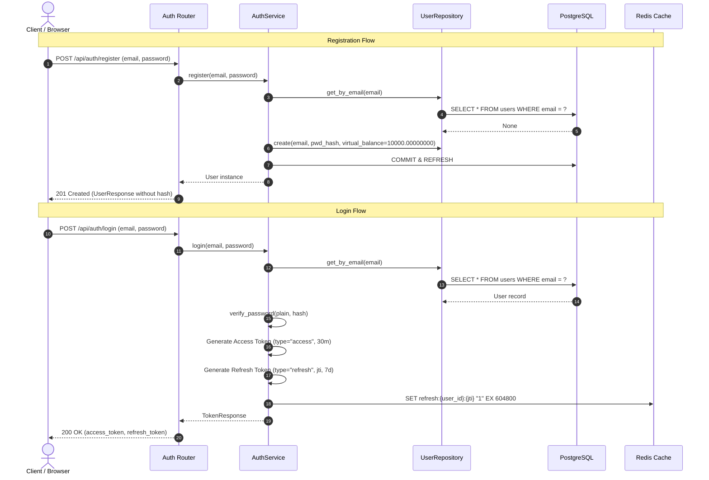
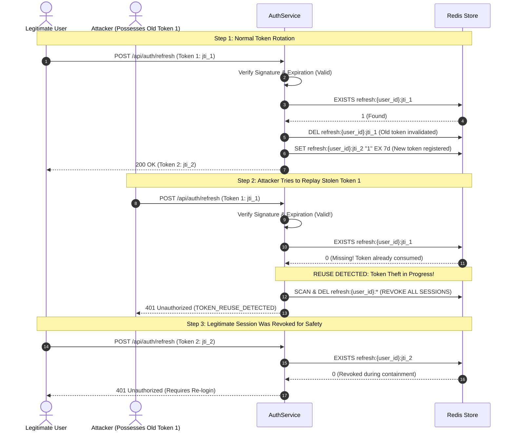

# Day 3 Implementation Walkthrough: Authentication, JWT Security & RBAC

**Crypto Trading Simulator** — Backend Engineering  
**Module:** Authentication & User Management  
**Status:** Completed & Fully Tested (27/27 Tests Passing)

---

## 1. Executive Summary

Day 3 delivered the complete production-grade authentication and authorization subsystem for the Crypto Paper-Trading Simulator. Built strictly according to the guidelines in [CLAUDE.md](file:///c:/Users/shams/OneDrive/Filess/CryptoTradingSimulator/CLAUDE.md), this system implements:

- **JWT Dual-Token Architecture**: Short-lived stateless access tokens (30 mins) and long-lived stateful refresh tokens (7 days).
- **Refresh Token Rotation & Storage**: Tracked in Redis via `refresh:{user_id}:{jti}` keys with automated TTL expiration.
- **Advanced Token Theft / Reuse Detection**: An automatic breach-containment mechanism that wipes all active sessions for a user if an unlisted or rotated refresh token is presented.
- **Strict Money & Precision Standards**: Zero `float` usage; exact `Decimal` arithmetic for virtual USD balances (`10000.00000000`), serialized as 8-decimal strings in JSON responses.
- **Role-Based Access Control (RBAC)**: Fine-grained permissioning distinguishing standard traders (`USER`) from system administrators (`ADMIN`).
- **Layered Architecture**: Absolute separation between thin HTTP routers ([app/routers/auth.py](file:///c:/Users/shams/OneDrive/Filess/CryptoTradingSimulator/app/routers/auth.py)), orchestration services ([app/services/auth_service.py](file:///c:/Users/shams/OneDrive/Filess/CryptoTradingSimulator/app/services/auth_service.py)), and isolated repositories ([app/repositories/user.py](file:///c:/Users/shams/OneDrive/Filess/CryptoTradingSimulator/app/repositories/user.py)).
- **Unified Error Responses**: Custom exception hierarchy formatting all errors into `{"error": {"code", "message"}}`.
- **Management CLI**: Command-line administrative tooling to seed or promote admin users.

---

## 2. System Architecture & Request Flows

### Authentication & Token Lifecycle Flow



---

## 3. Refresh Token Rotation & Reuse Detection

One of the most critical security features implemented is **Single-Use Refresh Token Rotation with Automated Breach Containment**.



### Why this design matters:
- **No Window for Replay Attacks**: A refresh token is immediately destroyed once exchanged.
- **Self-Healing Security**: If an adversary intercepts a token in transit and both parties attempt to use it, the system detects the anomaly immediately and purges all active session keys matching `refresh:{user_id}:*`, neutralizing the attacker's unauthorized access.

---

## 4. Endpoints & API Reference

All routes are mounted with OpenAPI schema documentation accessible at `/docs`.

| Method | Endpoint | Auth Required | Status Code | Purpose |
|---|---|---|---|---|
| `POST` | `/api/auth/register` | None | `201 Created` | Create user with `$10,000` virtual balance |
| `POST` | `/api/auth/login` | None | `200 OK` | Authenticate user; returns access + refresh token |
| `POST` | `/api/auth/refresh` | None (Token Body) | `200 OK` | Rotates refresh token, issues new pair |
| `POST` | `/api/auth/logout` | None (Token Body) | `200 OK` | Revokes refresh token in Redis |
| `GET` | `/api/auth/me` | Bearer Access Token | `200 OK` | Returns current user profile |
| `GET` | `/api/admin/stats` | Bearer Admin Token | `200 OK` | Admin-only route (`403` for standard users) |
| `GET` | `/health` | None | `200 OK` | Validates PostgreSQL & Redis connection status |

### Standardized Error Structure
Whenever a request fails, the application returns a structured JSON payload:
```json
{
  "error": {
    "code": "INVALID_CREDENTIALS",
    "message": "Invalid credentials"
  }
}
```

---

## 5. File Inventory & Modifications

### New Components Created
1. [`app/core/exceptions.py`](file:///c:/Users/shams/OneDrive/Filess/CryptoTradingSimulator/app/core/exceptions.py)
   - Exception hierarchy: `AppException`, `InvalidCredentialsError`, `TokenExpiredError`, `TokenInvalidError`, `TokenReuseError`, `UserAlreadyExistsError`, `ForbiddenError`, `NotFoundError`.
2. [`app/schemas/auth.py`](file:///c:/Users/shams/OneDrive/Filess/CryptoTradingSimulator/app/schemas/auth.py)
   - `UserRegisterRequest`, `UserLoginRequest`, `RefreshTokenRequest`, `TokenResponse`.
3. [`app/schemas/user.py`](file:///c:/Users/shams/OneDrive/Filess/CryptoTradingSimulator/app/schemas/user.py)
   - `UserResponse` with custom `@field_serializer` enforcing exact 8-decimal string formatting.
4. [`app/services/auth_service.py`](file:///c:/Users/shams/OneDrive/Filess/CryptoTradingSimulator/app/services/auth_service.py)
   - Full orchestration: registration, bcrypt hashing, login, token rotation, Redis session storage, and emergency session revocation.
5. [`app/routers/auth.py`](file:///c:/Users/shams/OneDrive/Filess/CryptoTradingSimulator/app/routers/auth.py)
   - Clean, decoupled HTTP endpoints.
6. [`app/routers/admin.py`](file:///c:/Users/shams/OneDrive/Filess/CryptoTradingSimulator/app/routers/admin.py)
   - Protected route demonstrating `require_admin` dependency.
7. [`app/cli.py`](file:///c:/Users/shams/OneDrive/Filess/CryptoTradingSimulator/app/cli.py)
   - Administrative CLI tool for user promotion and seeding (`create-admin`).
8. [`tests/test_auth.py`](file:///c:/Users/shams/OneDrive/Filess/CryptoTradingSimulator/tests/test_auth.py)
   - 17 unit and integration test scenarios.

### Existing Components Updated
- [`app/core/security.py`](file:///c:/Users/shams/OneDrive/Filess/CryptoTradingSimulator/app/core/security.py): Added bcrypt 4.x compatibility bridge; automated UUID `jti` assignment in token payloads.
- [`app/core/redis.py`](file:///c:/Users/shams/OneDrive/Filess/CryptoTradingSimulator/app/core/redis.py): Added modern `aclose()` graceful connection termination.
- [`app/api/deps.py`](file:///c:/Users/shams/OneDrive/Filess/CryptoTradingSimulator/app/api/deps.py): Implemented `get_current_user`, `require_role`, and `require_admin`.
- [`app/main.py`](file:///c:/Users/shams/OneDrive/Filess/CryptoTradingSimulator/app/main.py): Registered `auth` and `admin` routers; added global exception handlers.
- [`app/repositories/user.py`](file:///c:/Users/shams/OneDrive/Filess/CryptoTradingSimulator/app/repositories/user.py): Added `create` staging method.
- [`tests/conftest.py`](file:///c:/Users/shams/OneDrive/Filess/CryptoTradingSimulator/tests/conftest.py): Added `test_redis`, `app_instance`, and `client` fixtures.

---

## 6. Verification & Automated Test Results

Executed via Docker Compose inside the containerized environment:
```bash
docker compose exec -T api pytest -v
```

### Test Suite Output
```text
============================= test session starts ==============================
collected 27 items

tests/test_auth.py::test_register_success PASSED                         [  3%]
tests/test_auth.py::test_register_duplicate_email PASSED                 [  7%]
tests/test_auth.py::test_register_validation_short_password PASSED       [ 11%]
tests/test_auth.py::test_register_validation_invalid_email PASSED        [ 14%]
tests/test_auth.py::test_login_success PASSED                            [ 18%]
tests/test_auth.py::test_login_wrong_password PASSED                     [ 22%]
tests/test_auth.py::test_login_nonexistent_user PASSED                   [ 25%]
tests/test_auth.py::test_get_me_success PASSED                           [ 29%]
tests/test_auth.py::test_get_me_missing_token PASSED                     [ 33%]
tests/test_auth.py::test_get_me_expired_token PASSED                     [ 37%]
tests/test_auth.py::test_refresh_token_rotation PASSED                   [ 40%]
tests/test_auth.py::test_refresh_token_reuse_detection PASSED            [ 44%]
tests/test_auth.py::test_reject_access_token_as_refresh_token PASSED     [ 48%]
tests/test_auth.py::test_reject_refresh_token_on_protected_endpoint PASSED [ 51%]
tests/test_auth.py::test_logout PASSED                                   [ 55%]
tests/test_auth.py::test_admin_route_forbidden_for_user PASSED           [ 59%]
tests/test_auth.py::test_admin_route_allowed_for_admin PASSED            [ 62%]
tests/test_models.py::test_insert_user PASSED                            [ 66%]
tests/test_models.py::test_user_balance_check_constraint PASSED          [ 70%]
tests/test_models.py::test_insert_holding PASSED                         [ 74%]
tests/test_models.py::test_holding_unique_constraint PASSED              [ 77%]
tests/test_models.py::test_insert_trade PASSED                           [ 81%]
tests/test_models.py::test_trade_quantity_check_constraint PASSED        [ 85%]
tests/test_models.py::test_insert_watchlist PASSED                       [ 88%]
tests/test_models.py::test_insert_price_snapshot PASSED                  [ 92%]
tests/test_models.py::test_decimal_no_float_drift PASSED                 [ 96%]
tests/test_models.py::test_user_repository_crud PASSED                   [100%]

======================= 27 passed in 14.88s =======================
```

---

## 7. Interactive Swagger UI Verification Guide

Open [http://localhost:8000/docs](http://localhost:8000/docs) in your browser to run the full flow:

1. **Register**: Send `POST /api/auth/register` with `email` and `password` (min 8 chars).
2. **Login**: Send `POST /api/auth/login` to obtain `access_token` and `refresh_token`.
3. **Authorize**: Click the green **Authorize 🔓** button at the top-right of Swagger UI, paste the `access_token`, and click **Authorize**.
4. **Inspect `/me`**: Call `GET /api/auth/me` to see your user profile with `$10,000.00000000` starting virtual USD balance.
5. **Verify RBAC**: Call `GET /api/admin/stats` with your user token $\rightarrow$ returns `403 FORBIDDEN`.
6. **Seed Admin**: Run `docker compose exec api python -m app.cli create-admin --email admin@test.com --password AdminPassword123!`.
7. **Login as Admin**: Authenticate via `POST /api/auth/login` with admin credentials, update the Authorize modal, and re-run `GET /api/admin/stats` $\rightarrow$ returns `200 OK`.
8. **Test Rotation & Reuse**: 
   - Call `POST /api/auth/refresh` with the refresh token $\rightarrow$ returns a new token pair.
   - Call `POST /api/auth/refresh` again with the **same** initial token $\rightarrow$ returns `401 TOKEN_REUSE_DETECTED`.

---

## 8. Looking Ahead to Day 4

With authentication, persistent user balances, and Redis session management complete, Day 4 will focus on **Market Data Ingestion**:
- Binance WebSocket real-time price feed connection with exponential backoff & watchdog.
- In-memory price registry and tick publication to Redis pub/sub (`prices:{symbol}`).
- Client WebSocket broadcaster (`WS /ws/prices/{symbol}`).

