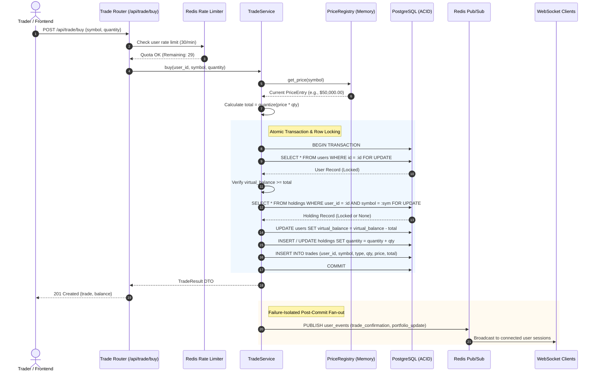
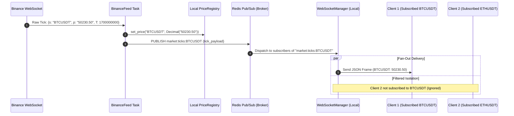

# System Architecture

**Project:** Crypto Paper-Trading Simulator  
**Architecture Style:** Layered Hexagonal / Clean Architecture with Async Event-Driven Real-Time Fan-Out  
**Technology Stack:** Python 3.12, FastAPI, SQLAlchemy 2.0 (asyncpg), PostgreSQL 16, Redis 7, Binance WebSocket Feed  

---

## 1. System Overview

The Crypto Paper-Trading Simulator is a high-performance, real-time backend platform enabling users to simulate cryptocurrency spot trading at live market prices streamed directly from Binance.

```mermaid
flowchart TD
    subgraph External ["External Services"]
        Binance["Binance WebSocket API<br/>(Live Ticks)"]
    end

    subgraph ClientLayer ["Clients"]
        Browser["Web / Mobile Browser"]
        WSClient["WebSocket Client"]
    end

    subgraph AppServer ["FastAPI Application (ASGI)"]
        direction TB
        MW["Middleware Stack<br/>(RequestId, RateLimit, SecurityHeaders, BodyLimit)"]
        Routers["HTTP Routers<br/>(Auth, Trade, Portfolio, Watchlist, Admin)"]
        WSHandlers["WebSocket Handlers<br/>(/ws/prices, /ws/portfolio)"]
        Services["Domain Services<br/>(TradeService, AuthService, PortfolioService, Analytics)"]
        Repos["Repositories<br/>(User, Holding, Trade, Pair, Watchlist)"]
        PriceReg["In-Memory Price Registry<br/>(Lock-free latest ticks & sequence counters)"]
        FeedTask["Binance Feed Background Worker<br/>(Auto-reconnecting resilient WS client)"]
        WSManager["WebSocket Connection Manager<br/>(Topic routing & client buffer management)"]
    end

    subgraph DataStore ["Persistence & Messaging"]
        PG[(PostgreSQL 16)<br/>ACID Storage, Row Locking]
        RedisStore[(Redis 7)<br/>Rate Limiting ZSets, Pub/Sub Fan-out, Cache]
    end

    Binance -->|Live Ticks| FeedTask
    FeedTask -->|Updates| PriceReg
    FeedTask -->|PUBLISH tick| RedisStore

    Browser -->|HTTP REST| MW
    MW --> Routers
    Routers --> Services
    Services --> Repos
    Services --> PriceReg
    Repos -->|Async SQL (asyncpg)| PG

    WSClient -->|WebSocket WS/WSS| WSHandlers
    WSHandlers --> WSManager
    RedisStore -->|SUBSCRIBE price_ticks| WSManager
    RedisStore -->|SUBSCRIBE user_events| WSManager
    WSManager -->|Push JSON Frame| WSClient

    Services -->|PUBLISH trade/portfolio update| RedisStore
```

---

## 2. Core Architectural Layers

The codebase adheres strictly to a 3-tier layered design pattern:

```
Routers (HTTP / WS Endpoints)
  │  (Validates DTOs, parses tokens, extracts rate limit headers)
  ▼
Services (Business Logic & Transactions)
  │  (Executes invariants, orchestrates locks, calculates PnL, publishes events)
  ▼
Repositories (Data Access Layer)
  │  (Executes queries, row-level locks, and persistence via SQLAlchemy Core/ORM)
  ▼
Models & Database (PostgreSQL Engine & Invariants)
```

1. **Routers (`app/routers/`):** Thin presentation layer. Responsible for parameter extraction, dependency injection (`Depends`), schema serialization, status codes, and HTTP exceptions. Contains zero business calculations.
2. **Services (`app/services/`):** Pure business logic layer. Manages database transactions, enforces domain invariants (e.g. balance constraints, trading rules), reads prices, and issues failure-isolated post-commit notifications.
3. **Repositories (`app/repositories/`):** Storage abstraction layer. Performs SQL queries, row-locking queries (`SELECT FOR UPDATE`), pagination, and atomic upserts. Does not contain trade execution or pricing rules.
4. **Core Infrastructure (`app/core/`):** Shared foundational modules:
   - `price_registry.py`: Lock-free memory cache of current market prices.
   - `rate_limit.py`: Sliding-window Lua rate limiting engine.
   - `middleware.py`: Request correlation IDs, payload caps, security headers.
   - `logging.py`: Structured JSON logger with automatic credential redaction.

---

## 3. High-Concurrency Trade Execution Flow

When a user executes a buy or sell order:
1. Live price is read lock-free from the in-memory `PriceRegistry`.
2. A single database transaction is initiated.
3. Row-level locks (`FOR UPDATE`) are acquired in a strictly deterministic sequence: **User row first, Holding row second**. This guarantees deadlock-free execution under extreme concurrency.
4. User balances and asset holdings are validated and updated.
5. A persistent trade audit row is written to the `trades` table.
6. The transaction commits atomically.
7. Post-commit, an asynchronous notification is dispatched to Redis Pub/Sub, broadcasting trade confirmations and updated portfolio valuations to active WebSockets.



---

## 4. Real-Time Price Tick Fan-Out Architecture

To deliver sub-millisecond price updates to thousands of connected clients without hitting Binance rate limits or saturating application memory:
1. A single centralized background worker (`BinanceFeed`) maintains an auto-reconnecting WebSocket connection to Binance's multi-stream ticker endpoint.
2. Incoming frames update the in-memory `PriceRegistry` instantly.
3. The tick is published to the Redis channel `market:ticks:{symbol}`.
4. All application worker replicas subscribe to Redis channels and fan out incoming messages to subscribed local WebSocket clients managed by `WebSocketManager`.
5. Slow or failing clients are isolated: slow consumer buffers drop laggy connections without blocking healthy subscribers.



---

## 5. Key Resilience & Concurrency Mechanisms

### 5.1 Deterministic Lock Ordering & Deadlock Prevention
Deadlocks occur when two concurrent transactions attempt to lock the same resources in differing orders (e.g. Tx A locks User then Holding; Tx B locks Holding then User).
- **Invariant:** All trade operations acquire locks in strict topological order:
  $$\text{User Row Lock} \longrightarrow \text{Holding Row Lock}$$
- By enforcing this order universally in `TradeService`, circular wait conditions are mathematically impossible.

### 5.2 Strict Decimal Precision Engine
- Floating point representations (`float` / IEEE 754) suffer from binary rounding errors (e.g. `0.1 + 0.2 != 0.3`). In a financial simulator, this allows users to compound fractional rounding errors.
- Every financial attribute (`virtual_balance`, `quantity`, `price`, `total_value`, `realised_pnl`) is typed as `decimal.Decimal` with 8 decimal places (`Numeric(18, 8)`).
- Rounding rules follow strict institutional conventions:
  - Buy debit: `ROUND_HALF_UP` on trade total.
  - Sell credit: `ROUND_DOWN` on user balance credit.
  - Holding average price: weighted-average calculation quantized to 8 places.

### 5.3 Deterministic FIFO Realized PnL Calculation
- Realized profit and loss (PnL) is computed using a pure First-In, First-Out (FIFO) accounting engine (`app/services/fifo_pnl.py`).
- Every buy trade creates an open lot `(quantity, price, timestamp, id)`.
- When a sell occurs, it matches against the oldest unconsumed buy lots in chronological order (tie-breaking deterministically on trade UUID).
- PnL is computed as:
  $$\text{Realised PnL} = \sum (\text{Sell Price} - \text{Buy Lot Price}) \times \text{Matched Quantity}$$

### 5.4 Cache Stampede Mitigation on Leaderboards
The global user leaderboard computes portfolio valuations across all active users. Under heavy traffic, simultaneous cache misses could trigger query stampedes.
- **Stampede Protection:** `LeaderboardCache` utilizes a Redis distributed mutex lock with a 5-second lease.
- When the cache expires, only one worker acquires the compute lock to query PostgreSQL and recalculate rankings; concurrent requests wait and read the refreshed cache, preserving database CPU.

### 5.5 Graceful Degradation & Fault Tolerance
- **Binance WebSocket Disconnection:** Exponential backoff with jitter reconnects automatically. If prices become older than 30 seconds, `PriceRegistry` marks them as stale, safely blocking new buys until fresh market data arrives while allowing users to liquidate holdings at the last known terminal price.
- **Redis Outage Behavior:**
  - Login / Register: **Fails closed** to prevent unmetered credential brute force.
  - General API: **Fails open** to maintain platform availability for authenticated traders.
  - Leaderboard: Degrades gracefully to direct SQL computation if Redis is unreachable.
